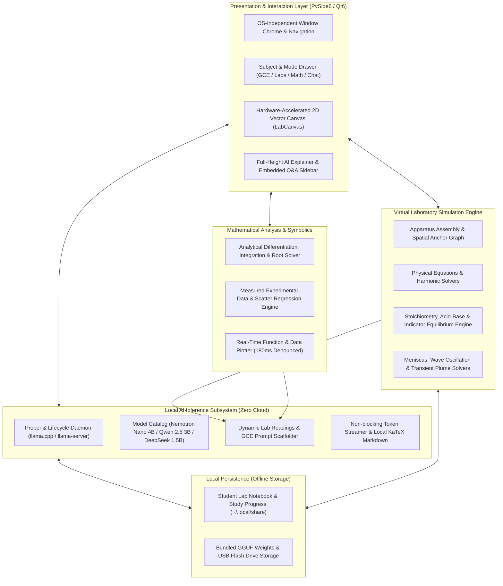
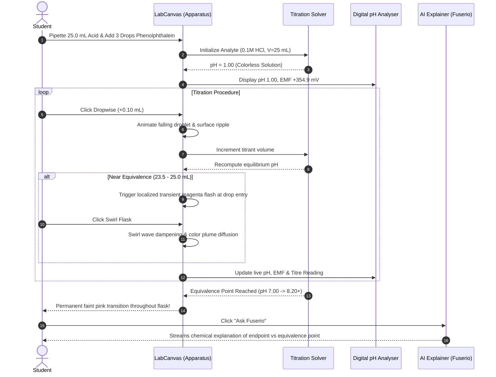
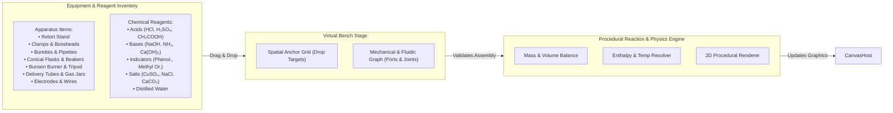
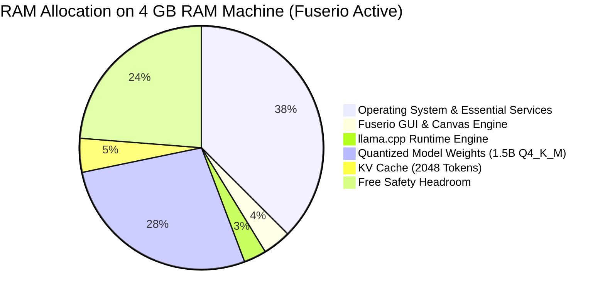
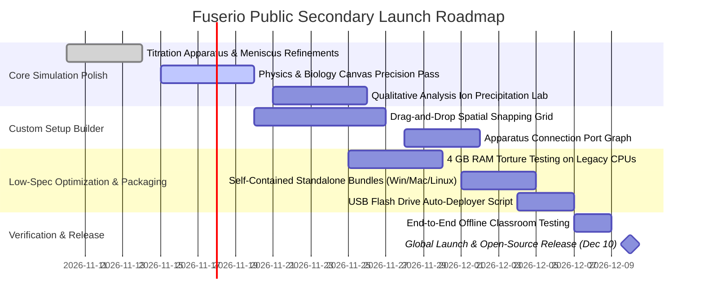

# FUSERIO: SYSTEM ARCHITECTURE & TECHNICAL BLUEPRINT
**Offline-First Virtual Science Laboratory & AI Study Companion for Secondary Education**

*Target Release Date: December 10*  
*Target Audience: Secondary School Science Students Worldwide (Ordinary & Advanced Level / GCE / WAEC / Secondary Curricula)*  
*Hardware Target: Low-Resource Environments (4 GB – 8 GB RAM, Multi-OS, Zero Internet Access)*

---

## 1. Executive Summary & Vision

### 1.1 The Core Mission
In secondary education globally—and particularly in developing nations and sub-Saharan Africa—practical science education faces acute barriers:
- **Equipment Scarcity**: School computer labs and science laboratories often lack fundamental glassware, functional meters, chemical reagents, and continuous electricity.
- **Safety & Cost Constraints**: Hazardous chemicals, fragile borosilicate glassware, and expensive consumables lead teachers to conduct "teacher-only demonstrations" rather than hands-on student experimentation.
- **The Internet Divide**: Cloud-based educational platforms fail in environments where internet connectivity is absent, intermittent, or prohibitively expensive.

**Fuserio** is engineered to eliminate these bottlenecks. It is a completely **offline-first, zero-telemetry desktop platform** that empowers students to perform **"Experiment Before Experiment"**—enabling them to:
1. Familiarize themselves with real laboratory apparatus (retort stands, burettes, pipettes, conical flasks, circuit components, microscopes).
2. Carry out end-to-end scientific procedures with physical accuracy before stepping into a high-stakes practical exam or physical laboratory.
3. Build and customize experimental rigs from scratch on a virtual workbench.
4. Receive patient, instant, step-by-step guidance from an embedded, quantized local Large Language Model (LLM) operating entirely on their computer with no internet connection.

---

## 2. System Architecture Design

Fuserio is structured into five decoupled subsystems designed to maintain high frame rates, deterministic mathematical models, and responsive local inference on modest hardware.



---

## 3. What Has Been Built So Far

### 3.1 Super-Realistic Acid-Base Chemistry Titration
The flagship laboratory module provides a standard analytical chemistry experience:
- **Authentic Apparatus Assembly**:
  - Heavy cast-iron beveled retort stand with rubber foot pads.
  - Polished vertical steel rod with metallic top cap.
  - Dual-prong clamps with rubberized grip pads holding the burette barrel firmly at two heights.
  - White ceramic contrast tile positioned squarely beneath the conical flask for endpoint discernment.
  - 250 mL Erlenmeyer conical flask with etched frosted graduations (`PYREX® 250mL`).
- **Class A 50.00 mL Precision Glass Burette**:
  - Millimeter ticks with numbered 10 mL intervals (0 to 50 mL).
  - Accurate curved concave **liquid meniscus** that descends as titrant is dispensed.
  - Rotatable **Stopcock Valve**: Teflon handle turns horizontal when closed, and switches to vertical/angled with streaming liquid when open.
  - Fine tapered glass delivery jet positioned directly over the flask mouth.
- **Interactive Laboratory Workbench (`titration_action`)**:
  - `🧪 Pipette 25 mL Acid`: Pipettes standard acid analyte into the flask.
  - `💧 Add Indicator (+1 drop)`: Phenolphthalein, Methyl orange, or Bromothymol blue. If 0 drops are added, the solution remains water-clear even at high pH, illustrating why indicators are required.
  - `🚿 Wash Neck (+5 mL H₂O)`: Rinses flask walls with distilled wash water without altering the moles of acid.
  - `💧 Dropwise (+0.10 mL)`: Precision single-drop delivery with falling teardrop animation and surface ripple.
  - `💧 Add +1.0 mL`: Coarse titrant addition when far from equivalence.
  - `🌀 Swirl Flask`: Fluid wave mixing that diffuses localized flashes into the bulk liquid.
  - `↺ Refill Burette`: Resets titrant volume back to 0.00 mL.
- **Physical Droplet & Transient Endpoint Bloom**:
  - Droplets form, detach, and fall straight down into the flask mouth.
  - Near the equivalence point, a localized, vibrant color plume flashes where the drop lands and diffuses outward upon swirling.
- **Digital Benchtop pH Analyser**:
  - Slender glass electrode probe immersed in the solution with an illuminated sensing bulb.
  - LCD display showing live `pH XX.XX`, EMF millivolts (`(7.0 - pH) * 59.16 mV`), and automatic temperature compensation (`25.0 °C · ATC ON`).
  - Dynamic status badge: `● ACIDIC BUFFER ZONE` ➔ `● NEAR ENDPOINT (DROPWISE)` ➔ `★ EQUIVALENCE (NEUTRAL)` ➔ `★ END POINT REACHED!` ➔ `● ALKALINE EXCESS`.



### 3.2 The Full Pre-Lab Experiment Catalog
Beyond titration, Fuserio includes interactive simulations across all three core natural sciences:
1. **Physics**:
   - *Projectile Motion*: Adjustable launch angle, velocity, and gravity; traces apex, range, and parabolic trajectory.
   - *Pendulum Lab*: Harmonic motion, string length variation, release angle, and air damping.
   - *Ohm's Law Circuit*: Voltage and resistance sliders with live current meter and power dissipation.
   - *Circuit Playground*: Interactive schematic bench where students add batteries, wires, switches, and bulbs to test closed circuits.
2. **Chemistry**:
   - *Acid-Base Titration*: Apparatus assembly, burette, conical flask, indicator drops, transient bloom.
   - *Reaction Kinetics*: Thermal particle collisions, concentration modulation, effective collision counting.
   - *Salt Solubility*: Water temperature, saturation limits, dissolved mass vs. undissolved precipitate crystals.
   - *Chemistry Playground*: Interactive beaker mixing water, salt, acid, and base with live pH tracking.
3. **Biology**:
   - *Membrane Diffusion*: Fick's Law simulation tracking particle movement across permeable barriers.
   - *Enzyme Activity*: Temperature-dependent collision rates vs. high-temperature denaturation curves.
   - *Natural Selection*: Generational trait frequency shifts under varying environmental pressures.

### 3.3 Math Data Lab
- **Function Plotter**: Renders linear, quadratic, polynomial, trigonometric, exponential, and rational expressions with a 180ms debounced plotting engine.
- **Experimental Data Analysis**: Accepts raw comma/tab/space-separated XY measurements, automatically calculates linear regression ($y = mx + c$), correlation coefficient ($R^2$), and sample standard deviation.
- **Dedicated Full-Height Right Sidebar ("Ask Fuserio")**:
  - Renders the mathematical function alongside an embedded, full-height AI tutoring panel.
  - Supports LaTeX math formatting via clean offline rendering.
  - Contains embedded follow-up question input for interactive tutoring.

### 3.4 Local AI Chat & Model Selector
- Fully offline inference communicating with local `llama-server` (llama.cpp) or Ollama.
- Elevated glassmorphic model selection bar featuring capability tags and resource metadata:
  - `🧠 Logic & Code` · Nemotron 3 Nano (4B Reasoning)
  - `⚡ Fast General` · Qwen 2.5 Instruct (3B Fast Chat)
  - `🔬 Math & Science` · DeepSeek R1 Distill Qwen (1.5B Compact Math Reasoning)
- Integrated token-per-second streaming monitor and auto-reconnect fallback.

---

## 4. The "Experiment Before Experiment" Paradigm & Custom Setup Builder

### 4.1 The Educational Rationale
In real secondary schools:
- Students often see laboratory equipment for the first time on exam day.
- Anxiety about breaking glassware or spilling acid hampers scientific inquiry.
- Practical exams grade procedure (how a burette is filled, zeroed, read at eye level with meniscus, and swirled).

Fuserio transforms practical preparation by providing a sandbox where mistakes carry zero risk, zero cost, and infinite repeatability.

### 4.2 Blueprint: The Custom Setup Builder ("Build from Scratch")
To allow students to construct their own bespoke experimental rigs, the next development phase introduces a node-based physical assembly workbench:



#### Assembly Logic & Rules
1. **Spatial Snap Points**:
   - Retort stand base anchors ceramic tile.
   - Retort rod anchors bosshead clamps at continuous vertical intervals.
   - Bosshead clamps hold cylindrical items (burettes, test tubes, condenser jackets).
   - Flask mouths accept funnels, rubber stoppers with delivery tubes, and electrode probes.
2. **Fluidic Port System**:
   - Each vessel possesses inlet ports (top opening) and optional outlet ports (burette stopcock tip, beaker pouring spout, delivery tube exit).
   - Reagents transfer only when source outlet is spatially aligned with destination inlet.
3. **Procedural Reaction Matrix**:
   - Implements generalized stoichiometry for precipitation ($Pb^{2+} + 2I^- \rightarrow PbI_2\downarrow$), gas evolution ($Zn + 2H^+ \rightarrow Zn^{2+} + H_2\uparrow$), and neutralization ($H^+ + OH^- \rightarrow H_2O$).

---

## 5. Universal Offline Distribution & Low-Spec Optimization

### 5.1 Hardware Constraint: The 4 GB & 8 GB RAM Target
Secondary school computer labs predominantly operate refurbished desktops and entry-level laptops running Windows 7/10/11, lightweight Linux distributions, or older Intel Macs. Fuserio is strictly budgeted to run within **4 GB of system RAM** without triggering swap memory thrashing.



### 5.2 Optimization Strategies
1. **Model Quantization (GGUF Q4_K_M)**:
   - DeepSeek R1 Distill Qwen 1.5B compressed to **~1.1 GB disk and RAM footprint**.
   - Qwen 2.5 3B compressed to **~2.1 GB**, recommended for 8 GB systems.
2. **Context Window Capping**:
   - Context window strictly bounded to **2048 tokens** to prevent memory ballooning during prolonged tutor sessions.
3. **Pure CPU Vectorized Execution**:
   - llama.cpp compiled with AVX2/NEON vector instructions.
   - Thread count automatically matches physical CPU cores (2–4 threads).
4. **Zero GPU Dependency**:
   - While Vulkan/Metal acceleration is supported when available, all graphics and simulations run entirely via CPU rasterization (`QPainter`) with dirty-rectangle repainting.
5. **No Polling Timers**:
   - All background tasks and subagents use reactive Qt event-driven signaling; CPU usage drops to 0.0% when the simulation is idle.

### 5.3 The USB Flash Drive & Offline "Sneakernet" Distribution
For schools with zero internet access, Fuserio is designed for **single-stick flash drive deployment**:

```
FUSERIO_PORTABLE_USB/
├── Fuserio-Linux.AppImage           (Self-contained Linux executable)
├── Fuserio-Windows-Portable.exe     (Self-contained Windows executable)
├── Fuserio-macOS.dmg                (Universal macOS bundle)
├── models/
│   ├── deepseek-r1-distill-qwen-1.5b-q4_k_m.gguf  (Primary 4GB target)
│   ├── qwen2.5-3b-instruct-q4_k_m.gguf            (Recommended 8GB target)
│   └── nemotron-3-nano-4b-q4_k_m.gguf             (Advanced logic target)
├── manuals/
│   ├── Student_Practical_Guide.pdf
│   └── Teacher_Installation_Manual.pdf
└── install_offline.bat / install_offline.sh
```
- **One-Click Local Copy**: Teachers plug the USB drive into classroom machines, run `install_offline`, and Fuserio is fully operational without a single packet of internet traffic.
- **Local P2P Classroom Sync (Future)**: Optional zero-configuration local Wi-Fi / Ethernet mDNS sharing allowing one teacher laptop to serve questions and receive student lab results over an isolated local network.

---

## 6. Technology Stack: Current State vs. Future Upgrades

| Subsystem | Current Implementation | Planned Future Evolution | Architectural Justification |
|---|---|---|---|
| **Core GUI Framework** | Python 3.11 + PySide6 (Qt6) | PySide6 with custom QML Canvas layers | Maintains standard Python ecosystem while unlocking hardware-accelerated declarative animations. |
| **2D Simulation Graphics** | Vector `QPainter`, `QPainterPath`, Gradients | Chipmunk2D / Box2D physics integration | Adds rigid-body apparatus gravity, collisions, and realistic cord/clamp tension. |
| **Fluid Mechanics** | Harmonic sinusoidal waves + radial alpha plumes | Smoothed-Particle Hydrodynamics (SPH) or 2D grid solver | Simulates true liquid pouring, droplet splashing, effervescent gas bubbling, and meniscus adhesion. |
| **Local LLM Engine** | Subprocess `llama-server` via localhost HTTP | Direct C/C++ in-process binding (`llama-cpp-python`) | Eliminates socket overhead, reduces RAM by 80 MB, and prevents port conflict errors. |
| **Mathematical Solver** | SymPy + custom analytical formulas | SymPy + WebAssembly / C-accelerated solver | Snappier high-degree polynomial derivations and multi-variable surface plots. |
| **Packaging & Bundling** | Shell scripts (`install.sh`, venv) | Briefcase / PyInstaller + AppImage + Windows MSIX | True single-click installation with no command-line interaction required by students. |

---

## 7. Making Animations & Simulations Hyper-Realistic

To achieve an experience that feels tangible and physically authentic:
1. **Volumetric Glassware Shader & Specular Lighting**:
   - Refraction indices for borosilicate glass ($n = 1.47$) vs. aqueous solutions ($n = 1.33$).
   - Dual-side specular highlight stripes that curve according to flask curvature.
2. **Droplet Mechanics & Coalescence**:
   - Tapered teardrop geometry governed by surface tension equations.
   - Viscosity-dependent dripping rates (dilute acids drip fast; concentrated glycerol or sulphuric acid flows with drag).
3. **Effervescence & Precipitation Particles**:
   - Gas generation (e.g. carbonate-acid reactions) creating ascending micro-bubbles that burst at the surface.
   - Precipitation reactions forming fine suspended crystalline flocculants that gradually settle to the vessel bottom.
4. **Thermal Dissipation & Color Gradients**:
   - Thermochromic indicators and exothermic reaction steam plumes during strong acid/base additions.

---

## 8. December 10 Release Roadmap



---

## 9. Contributor Guide & How to Get Involved

We warmly invite developers, science teachers, UI/UX designers, and open-source advocates to join the Fuserio mission:

### 9.1 Curriculum & Pedagogy Contributors
- **Lab Protocols**: Add GCE, WAEC, Cambridge, and national syllabus experiment configurations in `localchat/lab_data.py` and `localchat/chemistry_practicals.py`.
- **Structured Scaffolding**: Create targeted step-by-step guidance prompts for new practical topics (organic synthesis, optics, genetic crosses).

### 9.2 Simulation & Graphics Developers
- Implement new experimental apparatus models in `localchat/lab_widgets.py` (e.g. gas syringes, optical benches, calorimeters, electrolytic cells).
- Enhance particle and fluid rendering algorithms to maximize visual fidelity while maintaining 30 FPS on integrated Intel graphics.

### 9.3 Performance & Core Engineers
- Optimize memory usage and startup latency for 4 GB RAM machines.
- Refine cross-platform packaging for Windows, macOS, and Linux AppImages.
- Work on direct in-process bindings for llama.cpp to remove localhost socket overhead.

### 9.4 Community & School Ambassadors
- Test Fuserio on legacy hardware in local schools.
- Create USB flash drive distribution hubs for communities with limited internet access.
- Translate interface text and study materials into French, Spanish, Swahili, and regional languages.

---

*Fuserio is dedicated to every secondary school student with a curious mind, proving that quality science education should never be bounded by the walls of a physical laboratory or an internet connection.*
