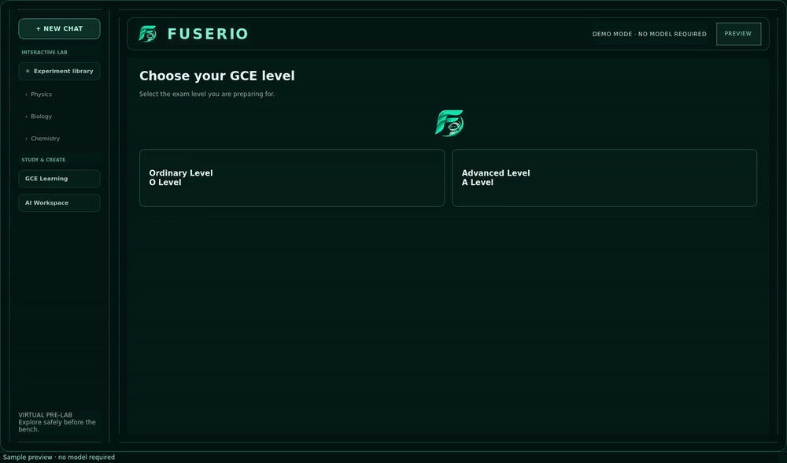

# Fuserio

**Your private local AI workspace and Cameroon GCE study tutor.** Fuserio runs as a desktop app and connects to llama.cpp on your computer.



[Download the MP4 version](assets/fuserio-demo.mp4)

The demo shows the GCE flow, a Physics answer being generated progressively with a live token counter, and a running projectile-motion experiment. It uses sample content and does not need or start an AI model.

## Get Started

### Requirements

- Ubuntu or another Linux desktop that supports Qt
- Python 3.11 or newer
- A local `llama.cpp` build and at least one model already available on your computer for AI chat

### Install and open

From a terminal, clone the repository and run the installer:

```bash
git clone https://github.com/iws3/Fuserio.git
cd Fuserio
./install.sh
```

Then open Fuserio from your desktop or application menu. You can also launch it from the project folder:

```bash
./fuserio.sh
```

The first screen lets you choose **Ordinary Level** or **Advanced Level**. Use **AI Workspace** in the sidebar for a general chat.

## Chat With a Local Model

Use the **Local Model** bar above the composer to choose a model. Each option shows its purpose, parameter size, and quantization. The connection control changes to **Connected**, **Loading**, or **Retry** as needed; Retry checks for a compatible server before starting another copy. Fuserio can start a model that is already cached for llama.cpp. To start one of the configured local servers yourself, use a separate terminal:

```bash
./start-nemotron.sh
```

Or:

```bash
./start-qwen.sh
```

Leave that terminal running, then open Fuserio. The app detects a compatible server on `127.0.0.1:8081`. The model files must already be present locally; Fuserio does not download models.

### Add DeepSeek R1 Distill Qwen 1.5B

This compact Q4 model is a practical first DeepSeek option for a CPU laptop. Downloading it requires an internet connection and about 1.1 GB of data. Run this once in a terminal; it starts a short test prompt and lets llama.cpp cache the model:

```bash
cd ~/llama.cpp
./build/bin/llama-cli \
	-hf bartowski/DeepSeek-R1-Distill-Qwen-1.5B-GGUF:Q4_K_M \
	-p "Explain Newton's second law in one sentence." \
	-n 80
```

Wait for the prompt to finish so the model is cached. Then select **DeepSeek R1 Distill Qwen** in Fuserio's Local Model bar. Fuserio does not start the download automatically; after it is cached, the app can start it offline.

## Interactive Science Lab

Choose Physics, Biology, or Chemistry in the **Interactive Lab** section of the sidebar. Each subject has three virtual pre-labs, including projectile motion, a pendulum, an Ohm's law circuit, membrane diffusion, enzyme activity, natural selection, reaction rates, titration, and states of matter.

Open an experiment to change its controls, run or pause the animation, adjust playback speed, or advance one step at a time. Live readings update as parameters change. Each lab shows its model equation, assumptions, and a safety note. Use the prediction and observation fields as a short lab notebook; notes are saved locally and restored when you reopen the experiment. **Ask Fuserio** sends the selected simulation and current readings to the local model for an explanation.

These are simplified computer models to explore ideas before a practical lesson. They do not replace teacher supervision, real laboratory safety rules, or official practical instructions. The sidebar retains direct access to GCE Learning and the general AI Workspace.

## GCE Study

1. Choose Ordinary Level or Advanced Level.
2. Choose Sciences, Arts, Languages, or Commercial.
3. Choose a subject to open its tutor chat.
4. Pick Lesson, Practice, Past-paper quiz, or Ask a question.

The tutor receives the selected level, stream, and subject. It is instructed to show full working for relevant calculation subjects, explain answers step by step, use Cameroon examples, and mark student attempts. Suggested topic areas are a starting scaffold, not a verified or exhaustive Cameroon GCE Board syllabus. Generated quiz questions are not presented as official past papers.

Your last selection, study modes, and conversations are saved locally in:

```text
~/.local/share/localchat/gce-progress.json
```

## Formatted Answers

The chat formats Markdown headings, lists, emphasis, and code blocks. Common LaTeX math is rendered as readable notation, including fractions, powers, roots, Greek letters, and operators. Rendering is local and does not load remote scripts or fonts.

## Privacy

Fuserio is designed for local use. Chat requests go to a llama.cpp server on your own computer; the app does not use cloud accounts or send prompts to a hosted AI service. A model must already be installed or cached to use it offline.

## Rebuild the Demo

The looping GIF is embedded above so it plays directly in GitHub's README. To recreate it after changing the interface, install FFmpeg if it is not already available, then run:

```bash
sudo apt install ffmpeg
.venv/bin/python scripts/capture_demo.py
```

The script captures the app's real screens with sample content, crossfades between them, and reveals the sample tutor answer progressively. It writes `assets/fuserio-demo.gif` and `assets/fuserio-demo.mp4`. It does not connect to a model or include personal chat history.

## Troubleshooting

- **The model selector does not become ready:** Confirm that `~/llama.cpp/build/bin/llama-server` exists and that the selected model is already cached locally.
- **A server is already using port 8081:** Stop that server before starting another one, or let Fuserio connect to the compatible server already running there.
- **Qt reports that the xcb platform plugin cannot load:** Your Linux installation may be missing a Qt xcb runtime library. Install the system package named in the Qt error, then reopen Fuserio.
- **The desktop icon is not updated:** Run `./install.sh` again to refresh the application launcher and logo.

## Project Files

- `localchat/` contains the desktop UI, local chat client, and GCE tutor flow.
- `localchat/lab_data.py` and `localchat/lab_widgets.py` contain the experiment catalog and offline simulations.
- `assets/fus-fuserio.png` is the app logo; `fus.png` is the supplied source artwork.
- `scripts/capture_demo.py` rebuilds the README demo.
- `tests/` contains the GCE flow and formatted math regression tests.
